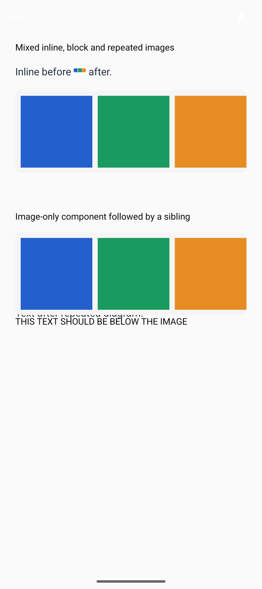

# Android Markdown image-height reproduction

A Markdown component with inline/block images and trailing text can draw its final paragraph over the components that follow it. The following image-only component is a control: the preceding Markdown content must end above its label.

## Run

```sh
bun install
bun run android
```

Wait for the images, then scroll to the bottom. **Text after repeated diagram** should appear before **Image-only component followed by a sibling**, rather than underneath that component's image.

Use a native development build, not Expo Go. This repository pins Expo 57.0.26, React Native 0.86.3 and enriched-markdown 1.1.0. The reproduction uses only React Native views and the package: no preview callback, navigation or backend. `diagram.png` is an original deterministic PNG fixture.

`main` uses the unpatched package. To compare the candidate, switch to `fixed`, run `bun install`, then rebuild with `bun run android`. JavaScript reload alone cannot apply a Kotlin change.

Before (unpatched Android 16 emulator):


